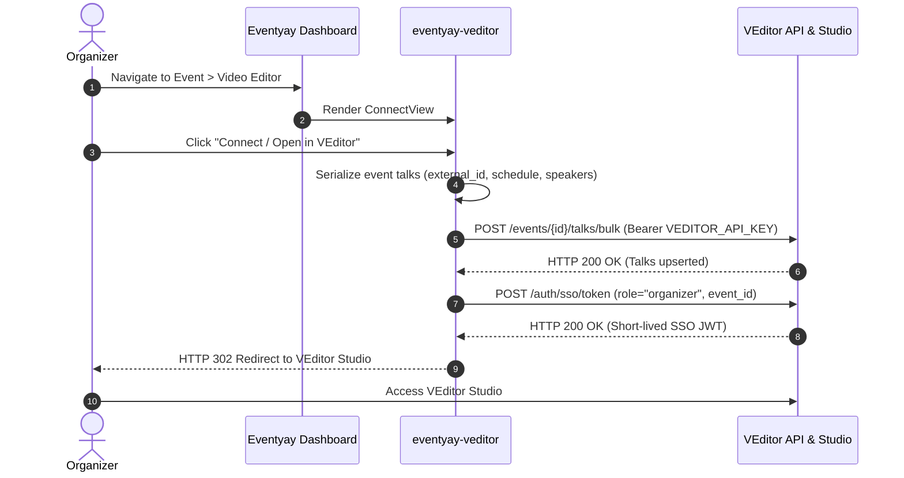
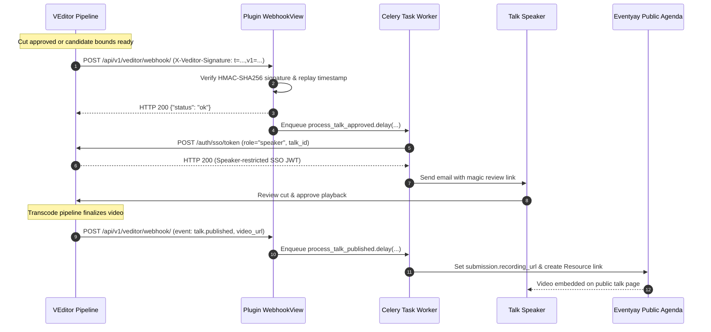

# eventyay-veditor

A plugin for [Eventyay](https://github.com/fossasia/eventyay) that integrates [VEditor](https://github.com/fossasia/veditor) for talk video review, trimming, and transcode workflows.

---

## Features

- **Talk & Schedule Synchronization**: Maps Eventyay scheduled sessions to VEditor talks via atomic bulk upsert (`POST /events/{id}/talks/bulk`) using stable `external_id` identifiers.
- **Single Sign-On (SSO) Handoff**: Allows event organizers to launch VEditor Studio directly from the Eventyay dashboard using short-lived SSO JWTs.
- **Inbound Webhook Receiver**: Receives HMAC-SHA256-signed pipeline lifecycle events (`X-Veditor-Signature`) from VEditor.
- **Automated Speaker Notifications**: Enqueues background Celery tasks on `talk.approved` / `talk.bounds_pending` to generate speaker-scoped review magic links and email speakers.
- **Public Schedule Integration**: Attaches published recording URLs directly to talk submissions and public session resources on `talk.published`.

---

## Architecture & Workflow

### 1. Organizer Connect & Schedule Sync (Outbound Flow)



### 2. Webhook Callback & Speaker Review (Inbound Flow)



---

## Security Model

- **Zero Passwords for Users**: Organizers and speakers never need separate accounts or passwords in VEditor. Authentication is handled through short-lived, cryptographically signed JSON Web Tokens (SSO JWTs).
- **Role-Scoped Access**:
  - `role: "organizer"`: Scoped to the event ID, allowing room video ingest, schedule trimming, and pipeline management.
  - `role: "speaker"`: Scoped strictly to an individual talk ID, restricting the user to previewing and reviewing their own talk.
- **Signature Verification**: Incoming webhook requests from VEditor must provide an HMAC-SHA256 signature in the `X-Veditor-Signature` header, supporting timestamped replay protection (`t=<timestamp>,v1=<digest>`).

---

## Configuration

Settings can be managed directly in the Eventyay Organizer UI, or configured at the platform level on the host Eventyay instance.

### Organizer UI Configuration

In the Eventyay dashboard under **Video Editor** (`ConnectView`), organizers can:
- Enter the **VEditor API Key** provisioned for the event.
- Optionally configure a custom **VEditor Service URL** (defaults to the platform URL if left empty).
- View the copyable inbound webhook endpoint URL.

Settings are saved directly to the event's settings store (`event.settings`).

### Platform-Wide Defaults (Host Eventyay Instance)

Platform administrators can configure global fallback defaults in Eventyay's environment or `settings.py`:

| Setting / Variable | Default | Description |
| :--- | :--- | :--- |
| `VEDITOR_API_BASE_URL` | `http://localhost:8000` | Fallback VEditor backend URL when not overridden per event. |
| `VEDITOR_API_KEY` | `None` | Default API key for instances sharing a single VEditor client. |
| `VEDITOR_WEBHOOK_SECRET` | `None` | Shared secret used to verify incoming webhook signatures. |
| `VEDITOR_REQUEST_TIMEOUT` | `10` | Timeout in seconds for VEditor API HTTP requests. |
| `VEDITOR_ALLOWED_ORIGINS` | `localhost, 127.0.0.1` | Comma-separated list of allowed host origins for redirects. |

---

## Local Development Setup

To test the integration locally, run Redis, VEditor, and Eventyay:

### 1. Start Redis

Redis is used by Celery in Eventyay and by RQ in VEditor:

```bash
docker run -d -p 6379:6379 --name veditor-redis redis:7-alpine
```

### 2. Set Up VEditor

Clone and start the VEditor backend:

```bash
git clone https://github.com/fossasia/veditor.git
cd veditor

# Install dependencies and run migrations
uv sync
uv run alembic upgrade head

# Create an API client for your test event
uv run python -m app.cli admin create-client --event-name "Local Test Event"
```

The `create-client` command will print the generated API Key and Webhook Secret:
```text
Created Client with ID 1
API Key: v_live_...
Webhook Secret: ...
```

Start the VEditor server:
```bash
uv run uvicorn app.main:app --host 0.0.0.0 --port 8000 --reload
```

In a separate terminal, start the VEditor background worker:
```bash
uv run python -m app.worker
```

### 3. Install the Plugin in Eventyay

In your Eventyay development environment:

```bash
cd /path/to/eventyay
source .venv/bin/activate

# Install the plugin in editable mode
uv pip install -e /path/to/eventyay-veditor

# Run migrations
python manage.py migrate
```

### 4. Start Eventyay and Celery Worker

Start the Eventyay development server:
```bash
python manage.py runserver 0.0.0.0:8080
```

In a separate terminal, start Celery to process background webhook tasks:
```bash
celery -A pretix.celery_app worker -l info
```

### 5. Connect an Event

1. Log in to Eventyay at `http://localhost:8080`.
2. Go to your event settings &rarr; **Plugins** &rarr; enable **VEditor Integration**.
3. In the event sidebar, click **Video Editor**.
4. Enter the API Key generated in step 2.
5. Click **Save Settings**, then click **Connect / Open in VEditor**.

---

## Webhook Specification

### Endpoint URL

The webhook receiver endpoint is located at:
```text
https://<your-eventyay-domain>/api/v1/veditor/webhook/
```

### Supported Events

| Event | Direction | Description |
| :--- | :--- | :--- |
| `ping` | Inbound | Connectivity test. Returns `{"status": "pong"}` when HMAC signature is valid. |
| `talk.bounds_pending` | Inbound | Candidate cut points ready. Dispatches speaker magic links via background email. |
| `talk.approved` | Inbound | Cut approved. Dispatches speaker magic links via background email. |
| `talk.published` | Inbound | Video finalized. Attaches recording URL to submission and adds public schedule resource. |

### Signature Verification

VEditor signs requests with an HMAC-SHA256 signature in the `X-Veditor-Signature` header:
- **Timestamped**: `t=<timestamp>,v1=<hex_digest>` (rejects requests with timestamp drift exceeding 300 seconds).
- **Prefixed**: `sha256=<hex_digest>`
- **Raw**: `<hex_digest>`

---

## Running Tests

The test suite includes unit tests and integration tests using an embedded `MockVEditor` server.

Run tests with `pytest`:

```bash
pytest tests/
```

Run specific test files:

```bash
pytest tests/test_client.py
pytest tests/test_views.py
pytest tests/test_webhooks.py
pytest tests/test_tasks.py
```

---

## Code Style & Linting

Code style is enforced with `pre-commit` and `ruff`:

```bash
uv run pre-commit install
uv run pre-commit run --all-files
```

---

## Troubleshooting

- **Webhook Signature Verification Failed (`401 / 403`)**: Ensure the webhook secret configured in Eventyay matches the secret in VEditor. For timestamped signatures (`t=...,v1=...`), verify that system clocks are synchronized within 300 seconds.
- **Speaker Emails Not Sent**: Verify that the Celery worker is running and connected to Redis, and that talk speakers have email addresses associated with their Eventyay user accounts.
- **SSO Token Expired or Rejected**: Ensure `VEDITOR_API_KEY` has access to the target event, and that system clocks are synchronized.
- **Redirect Blocked**: If running VEditor on a custom port or domain, ensure the domain is included in `VEDITOR_ALLOWED_ORIGINS`.

---

## Project Structure

```text
eventyay-veditor/
├── veditor/
│   ├── apps.py           # Plugin AppConfig and metadata
│   ├── client.py         # Outbound API gateway (bulk sync, SSO tokens, recording ingest)
│   ├── forms.py          # Settings and attachment forms
│   ├── mappers.py        # Eventyay Submission <-> VEditor Talk serializers
│   ├── recording.py      # Recording provider for public agenda video embed
│   ├── signals.py        # Signal receivers (navigation tab, recording provider)
│   ├── tasks.py          # Celery background tasks (speaker notifications, publishing sync)
│   ├── urls.py           # URL routing (organizer view, webhook endpoint)
│   ├── views.py          # Organizer connect view
│   ├── webhooks.py       # Webhook receiver with HMAC verification
│   ├── templates/        # HTML templates for organizer dashboard
│   └── static/           # Static assets
├── tests/
│   ├── conftest.py       # Test fixtures and MockVEditor test server
│   ├── test_client.py    # Client tests
│   ├── test_views.py     # Views and forms tests
│   ├── test_webhooks.py  # Webhook tests
│   └── test_tasks.py     # Celery task tests
├── pyproject.toml        # Dependencies and tool settings
└── README.md             # Documentation and setup guide
```

---

## License

Copyright FOSSASIA. Released under the terms of the [Apache License 2.0](LICENSE).
