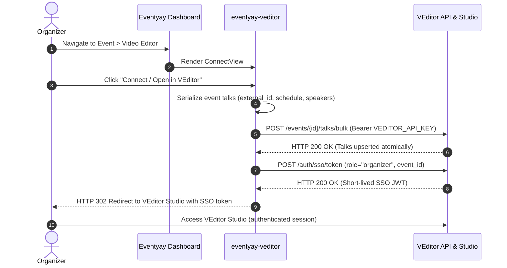
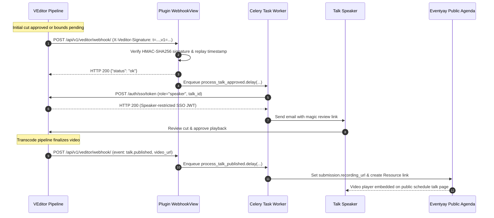

# eventyay-veditor

A plugin for [Eventyay](https://github.com/fossasia/eventyay) that seamlessly integrates [VEditor](https://github.com/fossasia/veditor), the automated talk video review, trimming, and transcode pipeline, directly into event agendas and organizer workflows.

---

## Overview & Architecture

`eventyay-veditor` provides a bidirectional bridge between Eventyay and VEditor:

1. **Outbound Flow (Organizer Handoff & Talk Sync)**:
   - Synchronizes event talks, schedules, and speakers via atomic bulk upsert (`POST /events/{id}/talks/bulk`) with stable `external_id` mapping.
   - Hands off event organizers directly into VEditor's multi-track cutting studio via short-lived, cryptographically signed Single Sign-On (SSO) JWTs without requiring organizers to create or manage secondary accounts.
2. **Inbound Flow (Webhooks, Speaker Reviews & Agenda Publishing)**:
   - Receives HMAC-SHA256-signed lifecycle webhooks (`X-Veditor-Signature`) from VEditor.
   - Dispatches background Celery tasks on `talk.approved` / `talk.bounds_pending` to generate speaker-scoped magic review links and notify speakers via email.
   - Automatically attaches final published video URLs to Eventyay talk submissions and session resources on `talk.published`, immediately embedding the recording player on the public schedule.

---

## Zero-Credential Security Model

The integration is built on a **zero-credential architecture** for both organizers and speakers:

- **No Passwords or Secondary Accounts**: Organizers and speakers never register separate passwords in VEditor.
- **Cryptographically Scoped SSO JWTs**:
  - **Organizers**: Granted `role: "organizer"` scoped to their specific event. Allows room recording uploads, schedule cuts, and pipeline management.
  - **Speakers**: Granted `role: "speaker"` scoped strictly to their individual talk ID via one-time magic links. Speakers are restricted to previewing their own talk and approving/requesting changes; they cannot view or alter other talks.
- **API Key & Webhook HMAC Verification**:
  - Communication from Eventyay to VEditor is authenticated using a high-entropy `VEDITOR_API_KEY`.
  - Inbound webhook calls from VEditor to Eventyay are verified using a shared `VEDITOR_WEBHOOK_SECRET` with HMAC-SHA256 signatures and timestamped replay protection (`t=<timestamp>,v1=<digest>`).

---

## Sequence Diagrams

### 1. Organizer Connect & Talk Bulk Sync (Outbound)



### 2. Webhook Callback, Speaker Magic Link & Publishing (Inbound)



---

## Configuration Reference

The plugin can be configured globally through environment variables / Django settings, or scoped per-event in the organizer settings UI:

| Variable / Setting | Source | Default | Description |
| :--- | :--- | :--- | :--- |
| `VEDITOR_API_BASE_URL` | Env / Settings / Event Override | `http://localhost:8000` | Base URL of the VEditor backend service (e.g. `http://veditor:8000` or `http://localhost:8000`). |
| `VEDITOR_API_KEY` | Env / Settings | `None` | Secret API key provisioned in VEditor for this Eventyay client. |
| `VEDITOR_WEBHOOK_SECRET` | Env / Settings / Event Override | `None` | Shared secret for verifying incoming HMAC-SHA256 webhook signatures. |
| `VEDITOR_REQUEST_TIMEOUT` | Env / Settings | `10` | HTTP client timeout in seconds for VEditor API requests. |
| `VEDITOR_ALLOWED_ORIGINS` | Env / Settings | `localhost, 127.0.0.1` | Comma-separated list of permitted host origins for browser redirects and embeds. |

A template configuration file is provided in [`.env.example`](.env.example).

---

## Local Development & Multi-Service Stack Setup

To test the complete integration locally, you need three running components:
1. **Core Eventyay** (Django / Pretix) with `eventyay-veditor` installed
2. **VEditor** (FastAPI backend + RQ workers)
3. **Redis** (Used for both Celery background tasks and VEditor RQ queues)

### Step 1: Start Redis

Ensure Redis is running locally on port `6379`:

```bash
docker run -d -p 6379:6379 --name veditor-redis redis:7-alpine
```

### Step 2: Set Up and Run VEditor

Clone and start the VEditor backend:

```bash
git clone https://github.com/fossasia/veditor.git
cd veditor

# Create environment and install dependencies
uv sync

# Run database migrations
uv run alembic upgrade head

# Bootstrap an API client for Eventyay
uv run python -m app.cli admin create-client --event-name "Local Test Event"
```

The `create-client` command will output your credentials:
```text
Created Client with ID 1
API Key: v_live_xxxxxxxxxxxxxxxxxxxxxxxx
Webhook Secret: xxxxxxxxxxxxxxxxxxxxxxxxxxxxxxxx
```

Start the VEditor API server:
```bash
uv run uvicorn app.main:app --host 0.0.0.0 --port 8000 --reload
```

In a separate terminal, start the VEditor background worker:
```bash
uv run python -m app.worker
```

### Step 3: Install `eventyay-veditor` into Eventyay

In your Eventyay development environment:

```bash
cd /path/to/eventyay

# Activate your Eventyay virtual environment
source .venv/bin/activate

# Install eventyay-veditor in editable development mode
uv pip install -e /path/to/eventyay-veditor

# Apply migrations
python manage.py migrate

# Configure environment variables in Eventyay's .env
export VEDITOR_API_BASE_URL="http://localhost:8000"
export VEDITOR_API_KEY="v_live_xxxxxxxxxxxxxxxxxxxxxxxx"
export VEDITOR_WEBHOOK_SECRET="xxxxxxxxxxxxxxxxxxxxxxxxxxxxxxxx"
```

### Step 4: Start Eventyay and Celery Worker

Start the Eventyay development server:
```bash
python manage.py runserver 0.0.0.0:8080
```

In another terminal, start the Celery worker to process webhook tasks:
```bash
celery -A pretix.celery_app worker -l info
```

### Step 5: Enable Plugin & Connect an Event

1. Open your browser to `http://localhost:8080` and log into the Eventyay organizer dashboard.
2. Navigate to your event settings &rarr; **Plugins** &rarr; enable **VEditor Integration**.
3. Under your event navigation sidebar, click **Video Editor**.
4. Review the talk schedule synchronization overview and click **Connect / Open in VEditor**.
5. Your browser will securely redirect to VEditor Studio with an authenticated session!

---

## Webhook Configuration

### Endpoint URL

The webhook receiver endpoint is registered at:
```text
https://<your-eventyay-domain>/api/v1/veditor/webhook/
```

### Supported Webhook Events

| Event | Direction | Trigger & Behavior |
| :--- | :--- | :--- |
| `ping` | Inbound | Connectivity test. Immediately returns `{"status": "pong"}` if HMAC signature is valid. |
| `talk.bounds_pending` | Inbound | Candidate cut points generated. Enqueues background Celery task to distribute speaker review magic links via email. |
| `talk.approved` | Inbound | Organizer approved initial cut. Enqueues background Celery task to distribute speaker review magic links via email. |
| `talk.published` | Inbound | Transcode completed. Attaches `video_url` to `submission.recording_url` and creates public `Resource` link. |

### Signature Verification Details

Every request dispatched by VEditor includes the `X-Veditor-Signature` header in one of the following formats:
- **Timestamped (Recommended)**: `t=<unix_timestamp>,v1=<hex_hmac>`
  - Protects against replay attacks by rejecting timestamps drifted by more than 300 seconds.
- **Prefix digest**: `sha256=<hex_hmac>`
- **Raw digest**: `<hex_hmac>`

---

## Running Tests

The test suite includes comprehensive unit tests and end-to-end integration tests using an embedded `MockVEditor` server.

To run tests with `pytest`:

```bash
pytest tests/
```

To run a specific test suite:

```bash
pytest tests/test_client.py
pytest tests/test_webhooks.py
pytest tests/test_tasks.py
pytest tests/test_views.py
```

---

## Code Style & Linting

This project enforces strict code style using `pre-commit` and `ruff`.

Install git pre-commit hooks:
```bash
uv run pre-commit install
```

Run checks manually across all files:
```bash
uv run pre-commit run --all-files
```

---

## Troubleshooting Guide

### 1. Webhook Signature Verification Failed (`HTTP 401 / 403`)
- **Secret Mismatch**: Verify that `VEDITOR_WEBHOOK_SECRET` in Eventyay matches the webhook secret configured in VEditor (either client-level or event-level).
- **Timestamp Drift**: If using timestamped signatures (`t=...,v1=...`), verify that system clocks on both servers are synchronized within 300 seconds via NTP.

### 2. Speaker Magic Link Emails Not Sent
- **Celery Worker**: Confirm that your Celery worker is running (`celery -A pretix.celery_app worker -l info`) and connected to Redis.
- **Email Backend**: Check Eventyay's mail settings (`EMAIL_BACKEND` or SMTP configuration in `pretix.cfg`).
- **Speaker Email Normalization**: Ensure speakers in Eventyay have valid email addresses assigned.

### 3. VEditor SSO Token Rejected or Expired
- **API Key Scopes**: Verify that `VEDITOR_API_KEY` has access to the target `event_id`.
- **System Clock Skew**: JWT `iat` and `exp` claims require synchronized server clocks.

### 4. Browser Redirect Blocked by Allowed Origins
- If running VEditor on a custom domain or non-standard port, add the domain to `VEDITOR_ALLOWED_ORIGINS` (e.g. `VEDITOR_ALLOWED_ORIGINS="localhost:8000,studio.example.org"`).

---

## Project Structure

```text
eventyay-veditor/
├── veditor/
│   ├── apps.py           # AppConfig & EventyayPluginMeta metadata
│   ├── client.py         # VEditor API gateway (bulk sync, SSO JWT, recording ingest)
│   ├── forms.py          # Organizer connection & recording attachment forms
│   ├── mappers.py        # Eventyay Submission <-> VEditor Talk serialisers
│   ├── recording.py      # VEditorRecordingProvider for agenda video embeds
│   ├── signals.py        # Django signals (nav links, recording provider registration)
│   ├── tasks.py          # Celery background tasks (speaker magic links, publish sync)
│   ├── urls.py           # URL routing (organizer dashboard, webhook receiver)
│   ├── views.py          # Organizer connect & recording attachment views
│   ├── webhooks.py       # HMAC-SHA256 inbound webhook receiver & verification
│   ├── templates/        # Semantic HTML templates matching Eventyay design system
│   └── static/           # Static assets
├── tests/
│   ├── conftest.py       # Pytest fixtures and MockVEditor test server
│   ├── test_client.py    # Client gateway unit tests
│   ├── test_tasks.py     # Celery task execution tests
│   ├── test_views.py     # Organizer views and attachment tests
│   └── test_webhooks.py  # Webhook verification & routing tests
├── .env.example          # Sample environment configuration
├── pyproject.toml        # Project dependencies and tool settings
└── README.md             # Documentation and developer setup guide
```

---

## License

Copyright FOSSASIA. Released under the terms of the [Apache License 2.0](LICENSE).
